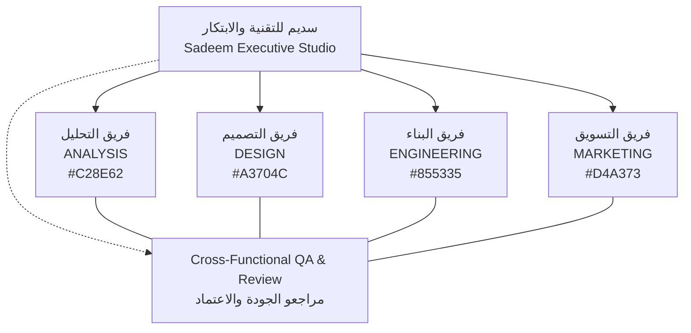

# SADEEM COMPANY MANAGEMENT SYSTEM — ARCHITECTURE SPECIFICATION

**Company:** سديم للتقنية والابتكار — Sadeem Technology & Innovation Studio  
**Branch:** `feature/company-management`  
**Framework:** Next.js 14 App Router, TypeScript, Tailwind CSS, Framer Motion, Prisma ORM 5.22.0  
**Database:** PostgreSQL (Neon / Local)  

---

## 1. Executive Summary & Design Principles

The Sadeem Company Management System is an enterprise-grade internal organizational platform embedded directly inside the Sadeem studio administrative application. It governs organizational hierarchy, permanent core departments, member lifecycles, role-based access control (RBAC), multi-step cryptographic invitations, task delegation, administrative guidance, and dual-actor audit tracking.

### Core Architectural Axioms
1. **Separation of Physical Person vs. System Credentials:**  
   Every employee, contractor, consultant, or collaborator is represented as a permanent `CompanyMember` record. A member does not require a login credential to exist in the organization chart or be assigned to projects. If granted dashboard access, a corresponding `AdminUser` record is linked.
2. **Deny-by-Default, Least Privilege RBAC:**  
   No role inherits open-ended permissions implicitly. Every operational action (member creation, team modification, task review, guidance issuance) is guarded by explicit permission checks.
3. **Multi-Step State Machine with Mandatory Admin Approval:**  
   Candidate invitation acceptance does NOT grant dashboard access. Acceptance records candidate confirmation and creates an administrative notification. Only explicit approval by an authorized administrator (`invitations:approve`) issues a secure single-use activation token.
4. **Immediate Session Invalidation on Suspension:**  
   Suspending a member flips `AdminUser.isActive` to `false` and atomically increments `AdminUser.tokenVersion`. Active JWT sessions across all devices are immediately invalidated on the next request.
5. **Safe Degradation of Email Delivery:**  
   If email delivery credentials (`RESEND_API_KEY`) are unconfigured, delivery attempts degrade safely into an offline outbox record marked `BLOCKED_CONFIGURATION` without crashing the transaction or falsely marking delivery as successful.

---

## 2. Departmental Architecture & Studio Structure

Sadeem operates with **four permanent core departments**:

### Department Definitions & Color Tokens
1. **ANALYSIS (فريق التحليل) — `#C28E62`:**  
   Market research, system requirements, feasibility studies, product roadmaps, data modeling, architecture planning.
2. **DESIGN (فريق التصميم) — `#A3704C`:**  
   UI/UX design, brand identity, interactive prototypes, design systems, visual assets, accessibility compliance.
3. **ENGINEERING (فريق البناء) — `#855335`:**  
   Full-stack development, database architecture, API development, cloud deployment, security auditing, system scaling.
4. **MARKETING (فريق التسويق) — `#D4A373`:**  
   Growth strategy, brand narrative, content strategy, launch campaigns, lead generation, client communication.

---

## 3. Module Hierarchy & Route Architecture

| Route | Purpose | Access Control |
| :--- | :--- | :--- |
| `/admin/company` | Executive overview, operational KPIs, pending approval alerts | `company:view` |
| `/admin/company/organization` | Interactive studio org chart & department explorer | `company:view` |
| `/admin/company/members` | Member directory, status filters, Add Member wizard | `members:view` |
| `/admin/company/members/[id]` | Member profile, roles, teams, tasks, suspension actions | `members:view` |
| `/admin/company/teams` | List of 4 core departments and secondary teams | `teams:view` |
| `/admin/company/teams/[id]` | Team scope, responsibilities, members, assigned projects | `teams:view` |
| `/admin/company/tasks` | Task board, priority, reviewer queue, AI metadata | `tasks:view_team` / `tasks:view_all` |
| `/admin/company/recommendations` | Administrative steering, guidance notes, acknowledgements | `recommendations:view_own` / `view_all` |
| `/admin/company/invitations` | Invitation lifecycle audit table, approve/reject/resend | `invitations:create` / `invitations:approve` |
| `/admin/company/notifications` | Personal & administrative in-app notification center | Authenticated session |
| `/admin/my-work` | Member workspace: assigned tasks, review queue, personal guidance | Authenticated session |
| `/join/invitation/[token]` | Public invitation review: candidate Accept/Decline (GET-safe) | Public (Cryptographic token) |
| `/join/activate/[token]` | Public password setup & account activation (single-use) | Public (Cryptographic token) |
