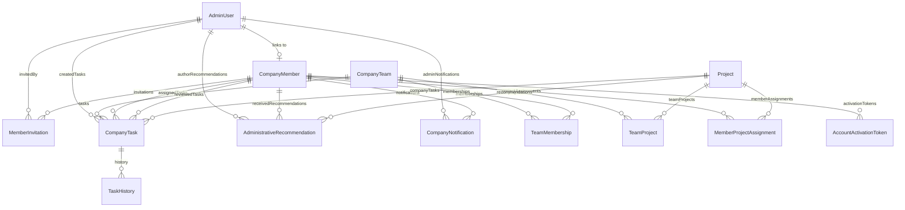

# SADEEM COMPANY MANAGEMENT SYSTEM — DATABASE SCHEMA

**Database Engine:** PostgreSQL 16+ / Neon Lakebase Postgres  
**ORM:** Prisma 5.22.0  
**Migration Path:** `prisma/migrations/20261109185000_add_company_management_system/migration.sql`  

---

## 1. Schema Diagram (ERD)

---

## 2. Model Definitions

### `CompanyTeam`
Represents core studio departments (Analysis, Design, Engineering, Marketing) and specialized sub-teams.
- `id` (String, cuid): Primary key
- `code` (String, unique): Short departmental code (e.g., `ANALYSIS`, `DESIGN`, `ENGINEERING`, `MARKETING`)
- `nameEn`, `nameAr` (String): Bilingual department titles
- `descriptionEn`, `descriptionAr` (Text): Scope descriptions
- `responsibilitiesEn`, `responsibilitiesAr` (Json): Ordered string array of responsibilities
- `color` (String?): Hex token (e.g., `#C28E62`)
- `icon` (String?): Lucide icon identifier
- `displayOrder` (Int, default 0)
- `isActive` (Boolean, default true)

### `CompanyMember`
Represents an individual's permanent organizational identity.
- `id` (String, uuid): Permanent UUID
- `employeeId` (String?, unique): Internal reference code (e.g., `SAD-26-8492`)
- `fullNameEn`, `fullNameAr` (String)
- `email` (String, unique): Official contact address
- `phone` (String?): Contact phone
- `avatarUrl` (String?): Profile photo
- `jobTitleEn`, `jobTitleAr` (String)
- `membershipType` (`EMPLOYEE`, `CONTRACTOR`, `CONSULTANT`, `FOUNDER`, `ADVISOR`)
- `status` (`PENDING_INVITATION`, `INVITED`, `ACCEPTED`, `APPROVED`, `ACTIVE`, `SUSPENDED`, `ARCHIVED`)
- `startDate` (DateTime?)
- `internalNotes` (Text?): Confidential administrative notes

### `TeamMembership`
Join table connecting a member to teams with explicit roles.
- `memberId` -> `CompanyMember.id` (Cascade)
- `teamId` -> `CompanyTeam.id` (Cascade)
- `isPrimary` (Boolean, default false): Exactly one primary team per member
- `teamRole` (`LEAD`, `MEMBER`, `REVIEWER`)
- Unique constraint: `[memberId, teamId]`

### `MemberInvitation`
Cryptographic state machine tracking invitation tokens.
- `id` (String, cuid)
- `memberId` -> `CompanyMember.id` (Cascade)
- `email` (String): Normalized target email
- `tokenHash` (String, unique): SHA-256 hash of the 32-byte raw token
- `status` (`PENDING`, `ACCEPTED`, `DECLINED`, `EXPIRED`, `REVOKED`)
- `deliveryStatus` (`PENDING`, `DELIVERED`, `FAILED`, `BLOCKED_CONFIGURATION`)
- `expiresAt` (DateTime): Expiration timestamp (default: 7 days)
- `invitedById` -> `AdminUser.id` (SetNull)

### `AccountActivationToken`
Single-use token issued upon administrative approval for password creation.
- `id` (String, cuid)
- `memberId` -> `CompanyMember.id` (Cascade)
- `tokenHash` (String, unique): SHA-256 hash of 32-byte raw activation token
- `expiresAt` (DateTime): Expiration timestamp (24 hours)
- `consumedAt` (DateTime?): Marked atomically upon password setup

### `CompanyTask` & `TaskHistory`
Task delegation with mandatory review gates and change tracking.
- `title`, `description`
- `priority` (`LOW`, `MEDIUM`, `HIGH`, `URGENT`)
- `status` (`TODO`, `IN_PROGRESS`, `IN_REVIEW`, `BLOCKED`, `DONE`, `CANCELLED`)
- `reviewRequired` (Boolean, default false)
- `isAiAssisted` (Boolean, default false) & `aiMetadata` (Json?)
- `assignedMemberId`, `reviewerMemberId`, `teamId`, `projectId`
- `TaskHistory` records `actorId`, `action`, `fromStatus`, `toStatus`, `metadata`

### `AdministrativeRecommendation`
Structured guidance, steering, and performance notes.
- `targetMemberId` -> `CompanyMember.id`
- `authorId` -> `AdminUser.id`
- `type` (`GUIDANCE`, `IMPROVEMENT`, `TRAINING`, `PROCESS`, `DIRECTION`, `FOLLOW_UP`)
- `priority` (`LOW`, `MEDIUM`, `HIGH`, `URGENT`)
- `status` (`PROPOSED`, `ACKNOWLEDGED`, `IN_PROGRESS`, `RESOLVED`, `ARCHIVED`)
- `visibility` (`PRIVATE_MANAGEMENT`, `SHARED_WITH_MEMBER`, `TEAM_VISIBLE`)
- `acknowledgedAt` (DateTime?)

### `CompanyNotification`
In-app notification dispatch.
- `recipientAdminId` -> `AdminUser.id`
- `recipientMemberId` -> `CompanyMember.id`
- `type` (`INVITATION_ACCEPTED`, `MEMBER_APPROVED`, `ACCOUNT_ACTIVATED`, `TASK_ASSIGNED`, `TASK_STATUS_CHANGED`, `TASK_REVIEW_REQUESTED`, `RECOMMENDATION_ISSUED`, `SYSTEM_ALERT`)
- `read` (Boolean, default false) & `readAt` (DateTime?)

### `EmailOutbox`
Durable tracking for outbound emails.
- `recipientEmail`, `subject`, `template`, `payload` (Json)
- `status` (`PENDING`, `DELIVERED`, `FAILED`, `BLOCKED_CONFIGURATION`)
- `providerId` (String?), `error` (Text?), `attempts` (Int)
