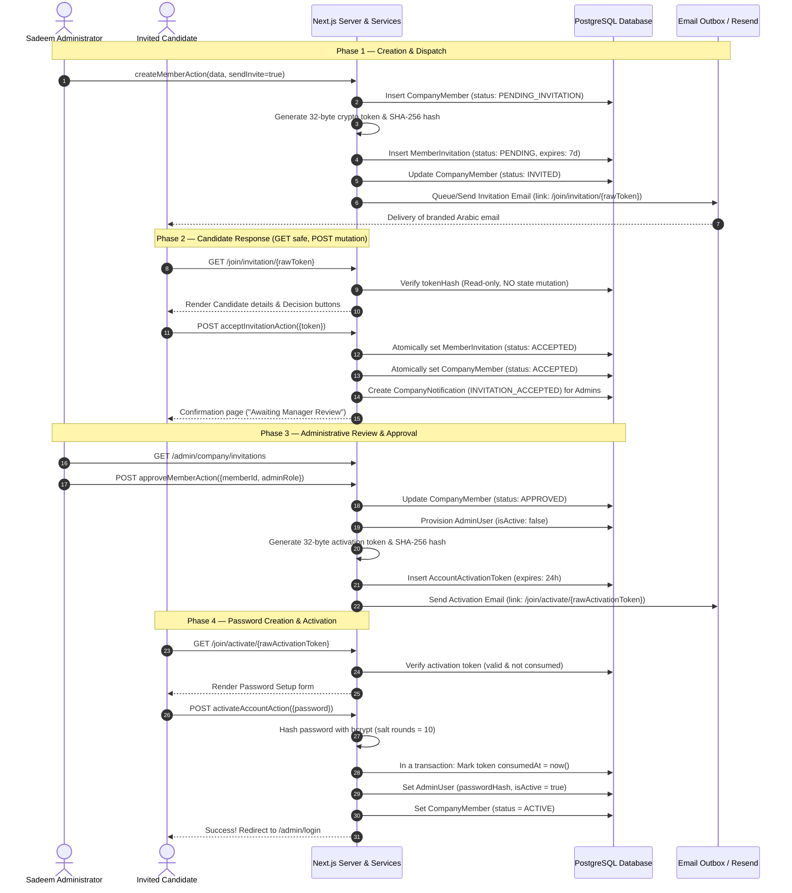

# SADEEM COMPANY MANAGEMENT SYSTEM — INVITATION & ACTIVATION WORKFLOW

**Implementation:** `src/lib/services/invitationService.ts`, `src/lib/services/companyMemberService.ts`  
**Public Routes:** `/join/invitation/[token]`, `/join/activate/[token]`  

---

## 1. Multi-Step State Machine

The invitation lifecycle enforces a multi-step verification sequence designed to prevent unauthorized account creation, email enumeration, link crawler side-effects, and credential exposure.

---

## 2. Key Security Properties

### Cryptographic Token Storage
- Plaintext tokens are **never stored in the database**.
- Each link contains a 32-byte cryptographically random hex string (`crypto.randomBytes(32).toString("hex")`).
- The database stores only the `SHA-256` digest:
  $$\text{tokenHash} = \text{SHA-256}(\text{rawToken})$$
- Even in the event of an unauthorized database read, tokens cannot be forged or redeemed.

### Idempotency & Single-Use Enforcement
- **GET Safety:** Visiting `/join/invitation/[token]` executes a strictly read-only check (`verifyInvitationToken`). Link preview bots, antivirus scanners, and crawler pre-fetching do NOT trigger state changes.
- **Single-Use Activation:** `AccountActivationToken` has an atomic guard:
  `if (activationRecord.consumedAt !== null) throw new Error("ALREADY_USED");`
  Subsequent redemption attempts are rejected immediately.

### Absolute Deny on Expired Tokens
- Invitation links expire after 7 days by default.
- Activation links expire after 24 hours.
- Expired links cannot be redeemed under any condition.
